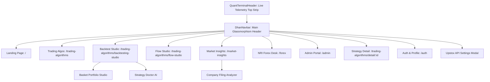

# Apex Quant Terminal: Git-Driven Functional & UI Prototyping Blueprint

> **Document Type:** Institutional System Architecture & UI Prototyping Specification  
> **Source Repository:** `Arthaton Finance Project` (`main` branch)  
> **Target Audience:** Google Stitch (UI Prototype Generator) & Quantitative Frontend Engineers  
> **Target UI Design Mode:** Strictly 100% Light Theme Institutional Interface  

---

## 1. System Identity, Design System & Core Architecture

### 1.1 Brand Identity & Positioning
* **Platform Name:** Apex Quant (Arjuna NSE Quant Workstation)
* **Tagline:** Institutional Systematic Strategy Engineering & Multi-Asset Portfolio Allocation.
* **Core Value Proposition:** Deterministic, rule-based quantitative models evaluated on authentic market data with zero discretionary emotion.
* **Target Audience:** Quantitative traders, HNIs, NRIs trading global currencies/metals, and algorithmic fund researchers.

### 1.2 Design Philosophy & Visual Tokens
* **Theme Specification:** Strictly 100% Light Institutional Palette (Swiss / Bloomberg Next-Gen Daylight).
* **Color System:**
  * **Background Base:** `#F5F5F7` (soft daylight neutral surface)
  * **Card & Elevated Surfaces:** `#FFFFFF` (pristine white with subtle border `#E5E7EB` and soft shadow `shadow-xs`)
  * **Primary Typography & Accents:** `#0A0A0D` / `#151515` (deep high-contrast graphite)
  * **Secondary / Meta Typography:** `#4B5563` / `#6B7280` (refined neutral grays)
  * **Alpha / Positive P&L / Bullish:** `#059669` (emerald green) / badge tint `#ECFDF5`
  * **Drawdown / Stop Loss / Bearish:** `#E11D48` (rose crimson) / badge tint `#FFF1F2`
  * **Forex & Global Desk Accent:** `#0891B2` (cyan / marine) / badge tint `#ECFEFF`
* **Typography:**
  * **Body & UI Elements:** `Inter`, `SF Pro Display`, or system sans-serif (weights: 400, 500, 600, 700).
  * **Numbers, Timestamps, Ratios & Code:** `JetBrains Mono`, `Roboto Mono`, or tabular monospace (tabular figures enabled).

### 1.3 Data Pipeline & Live Feed Integrations
* **Live Feed 1 (Intraday & Historical Quotes):** Yahoo Finance Intraday 15m & Daily API (serving `EURUSD=X`, `GBPUSD=X`, `GC=F`, `SI=F`, `USDINR=X`, and Indian equities).
* **Live Feed 2 (Direct NSE Tick Data):** Upstox V2 WebSocket & REST API (1m, 5m, 15m, 30m, 1d candle bars).
* **Live Intelligence Engine:** Groq LPU 120B LLM (macro commentary, strategy diagnostics, balance sheet filing audit).
* **Zero-Mock Policy:** All performance figures, drawdowns, and trade executions are computed bar-by-bar across authentic price series.

---

## 2. Global Shell & Persistent Navigation Infrastructure



### 2.1 High-Frequency Telemetry Top Ribbon (`QuantTerminalHeader.tsx`)
A persistent, compact monospace telemetry strip pinned to the absolute top of the viewport:
* **NSE Cash Feed Indicator:** Pulsing emerald orb with label `NSE CASH: LIVE FEED`.
* **Latency Counter:** `LATENCY: 12ms (Direct NSE Stream)`.
* **Market Breadth Telemetry:**
  * `NIFTY 50-EMA`: Percentage of index stocks currently trading above their 50-day EMA (`72% Above`).
  * `FII/DII FLOW`: Daily net institutional cash flow in INR Crores (`+₹2,827 Cr`).
  * `G-SEC (Rf)`: Indian Sovereign 10-Year Risk-Free Rate benchmark (`6.50%`).
  * `GROQ LPU`: LLM quantitative inference engine status (`120B Quant`).
* **Direct NRI/Forex Desk Launch Button:** Quick switch button with globe icon and cyan border: `NRI / FOREX DESK (EUR·GBP)`.
* **Regulatory & Compliance Badge:** Shield icon with label `SEBI & FEMA COMPLIANT`.

### 2.2 Institutional Navigation Bar (`DhanNavbar.tsx`)
A sticky navigation header with glassmorphism backdrop blur:
* **Brand Monogram:** Rounded square badge with `AQ` monogram in deep graphite, accompanied by the brand name `apex quant`.
* **Primary Navigation Tabs:**
  1. **Overview (`/`):** Platform landing, philosophy, and audited returns.
  2. **Trading Algos (`/trading-algorithms`):** Active strategy catalog with counter pill (`9 Active`).
  3. **Backtest Studio (`/trading-algorithms/backtesting-studio`):** Vectorized historical lab with pill (`Yahoo Daily`).
  4. **Flow Canvas (`/trading-algorithms/flow-studio`):** Visual node graph builder with pill (`n8n Nodes`).
  5. **Market Insights (`/market-insights`):** Macro regime breadth, VIX, and corporate fundamental filings.
  6. **NRI Forex Desk (`/forex`):** ICT session liquidity sweep desk with pill (`EUR/GBP`).
  7. **Admin Portal (`/admin`):** Algorithm authoring, publishing controls, and parameter defaults.
* **Right Quick Action Controls:**
  * Quick-launch Forex button (`NRI / Forex Portal`).
  * "Algorithms" marketplace switcher.
  * Primary CTA: `Launch Backtest` button with trending up icon in deep graphite `#0A0A0D`.
  * User profile dropdown showing avatar, user role badge (`Admin` or `Quant Trader`), and sign-out option.

### 2.3 Terminal Footer
* Persistent bottom bar featuring:
  * Green status indicator: `Real Bar-by-Bar Vectorized Quantitative Backtesting`.
  * Center text: `Institutional Systematic Strategy Engineering · Multi-Asset Portfolio Allocation`.
  * Brand tagline: `Apex Quant Research Workstation`.

---

## 3. Screen-by-Screen Functional Blueprint

---

### SCREEN 1: Institutional Landing Page (`LandingPage.tsx`)
* **Route:** `/`
* **Purpose:** Public portal establishing institutional credibility, displaying audited metrics, and funneling users to the trading marketplace or backtesting sandbox.

#### Visual & Functional Components
1. **Hero Section:**
   * **Headline:** "Results you can actually follow."
   * **Subtitle:** "Performance analytics and systematic algorithm baskets for NSE equities and options. Zero emotional guesswork. Pure mathematical edge verified across historical market regimes."
   * **CTA Row:** "Open Dashboard" (primary graphite button with arrow icon) and "Explore Strategies" (secondary outline button).
   * **Benchmark Ribbon:**
     * `BENCHMARK: NIFTY 50`
     * `DATA: 7+ Years NSE Tick Archive`
     * `ORDERS: Limit Orders Only`
2. **Featured Audited Card (`NIFTY_ALPHA_V4` Summary):**
   * Pinned card with green status dot and `AUDITED` badge.
   * **4-Metric Quad-Grid:**
     * `1-Year Return`: `+114.6%` (Compound Annual Growth)
     * `Sharpe Ratio`: `2.84` (measured against 6.50% Sovereign G-Sec)
     * `Win Rate`: `72.5%` (across 1,482 verified historical executions)
     * `Max Drawdown`: `-3.40%` (recovery time: 5.2 days)
   * Quick action button: "View in Strategy Studio".
3. **Architecture Pillars (01 // Platform Architecture):**
   * *Rules in, orders out:* Codified deterministic rules (exact entry, ATR-weighted stop loss, pre-calculated targets).
   * *Drawdown & risk control:* Fixed fraction sizing (1% to 2% max risk per execution) with dynamic trailing stops.
   * *Numbers that hold up:* Multi-regime historical stress tests (elections, budgets, volatility spikes).
4. **Featured Algorithms Section (02 // Algorithms & Baskets):**
   * Two-state segment control:
     * **Trading Algorithms**
     * **Investment & Wealth Algos (Below ₹1.1L)**
   * Dynamic algorithm cards grid with stock logos, performance metrics, and direct links.
5. **Interactive FAQ Accordion:**
   * Explanations covering simulated paper execution, difference between trading & investing systems, statutory friction, and drawdown metrics.
6. **Regulatory Disclosures:**
   * SEBI statutory disclaimers on algorithmic trading and simulated past performance.

---

### SCREEN 2: Trading Algorithms Marketplace (`DhanMarketplace.tsx`)
* **Route:** `/trading-algorithms`
* **Purpose:** Catalog of systematic strategies with multi-tier filtering, capital requirements, and real-time paper portfolio tracking.

#### Visual & Functional Components
1. **Sub-View Navigation Tabs:**
   * `Trading Algorithms`: Active intraday & swing momentum systems.
   * `Investment & Wealth`: Low-capital, automated wealth accumulation models (Under ₹1,10,000).
   * `Tracked Strategies (Watchlist)`: User's saved strategies.
   * `Active Positions`: Live simulated open paper trades (Asset, Entry, Current Price, Trailing SL, P&L INR, Return %).
   * `Order History`: Historical order book with execution timestamps, slippage, and brokerage.
2. **Search & Multi-Tier Filter Controls:**
   * Free-text search bar with live auto-complete.
   * **Capital Requirement Dropdown:**
     * `ALL`, `< ₹10,000`, `< ₹50,000`, `< ₹100,000`, `< ₹200,000`, `> ₹200,000`.
   * **Strategy Style Dropdown:**
     * `ALL`, `SWING`, `BREAKOUT`, `VOLATILITY`, `WEALTH ACCUMULATION`, `OVERNIGHT`.
3. **Algorithm Card Component:**
   * Stock/Index Logo (`StockLogo`).
   * Strategy Name, Tagline, and Capital Tier Badge.
   * Verification Badge: `Audited Quant Strategy`.
   * **Performance Quad:**
     * 1-Year Rolling Return (%)
     * Sharpe Ratio
     * Win Rate (%)
     * Max Peak-to-Trough Drawdown (%)
   * SVG Sparkline mini equity trajectory.
   * Action Controls: Bookmark icon (Watchlist toggle), "Backtest" button, and card click to open Strategy Detail.

---

### SCREEN 3: Strategy Deep-Dive & Quantitative Audit (`DhanStrategyDetail.tsx`)
* **Route:** `/trading-algorithms/detail/:id`
* **Purpose:** In-depth quantitative inspection, mathematical audit, equity growth curves, codified rules, and code export.

#### Visual & Functional Components
1. **Strategy Header & Telemetry:**
   * Asset Name, Instrument Key, Timeframe (`5m`, `15m`, `1d`), Capital Tier, Margin Requirement.
   * Paper-trading toggle switch (Active / Inactive).
2. **Institutional Audit Matrix (`StrategyQuantAudit.tsx`):**
   * Total Trades Count, Winning Trades, Losing Trades.
   * Profit Factor (Gross Wins / Gross Losses).
   * Sortino Ratio (Downside deviation measure).
   * Calmar Ratio (Annualized Return / Max Drawdown).
   * Mathematical Expectancy per trade.
   * Average Trade Duration (in bars and calendar days).
3. **Interactive Charts:**
   * **Cumulative Equity Curve (`EquityLineChart.tsx`):** Strategy balance path plotted against NIFTY 50 benchmark.
   * **Underwater Drawdown Chart (`QuantUnderwaterChart.tsx`):** Peak-to-trough decline visualization.
4. **Codified Rule Specification:**
   * Detailed operational rules:
     * Condition 1: Market session & entry trigger.
     * Condition 2: Dynamic Stop Loss formulation.
     * Condition 3: Take Profit calculation & RR multiplier.
     * Condition 4: Capital allocation formula.
     * Condition 5: Session close square-off rules.
5. **Code Export Suite:**
   * Tabbed code viewer displaying production-ready **Pine Script v5** code and **Python Backtrader** script with one-click clipboard copying.
6. **Live Sandbox Order Dispatcher:**
   * Configure paper trade lot size, slippage tolerance, and execute instant dry-run orders.

---

### SCREEN 4: Backtest Studio (`BacktestStudio.tsx`)
* **Route:** `/trading-algorithms/backtesting-studio`
* **Purpose:** Core quantitative laboratory for testing single-asset and multi-asset algorithmic strategies across tick historical data.

#### Visual & Functional Components
1. **Studio Mode Switcher:**
   * **Mode A: Single-Asset Backtest Studio.**
   * **Mode B: Multi-Asset Basket Portfolio Studio.**
2. **AI Natural Language Strategy Synthesizer (`NaturalLanguagePromptBar.tsx`):**
   * Prompt bar powered by Groq LLM allowing traders to type natural instructions (e.g., *"Test an ORB strategy on RELIANCE 5M with 70% candle body SL and 1:2 RR"*), which automatically configures the parameter engine.
3. **Comprehensive Parameter Panel:**
   * **Asset Selector:** Searchable dropdown of 500+ NSE stocks and indices (with live company logos).
   * **Timeframe:** `1m`, `5m`, `15m`, `30m`, `1d`.
   * **Data Provider:** `Yahoo Finance` (Historical daily & intraday up to max archive) or `Upstox V2 API` (Direct NSE tick data).
   * **Historical Range:** `1m`, `3m`, `6m`, `1y`, `2y`, `5y`, `max`, or `custom` date range picker.
   * **Pre-Loaded Strategy Engines:**
     * **Engine 1: Nifty50 Trend-Pullback Chandelier**
       * Fast EMA (50), Slow EMA (200), Trend Slope Lookback (20 bars).
       * ADX Trend Filter (Period 14, Minimum threshold 20.0).
       * RSI Pullback (Period 5, Oversold 30.0, Overbought 70.0).
       * Chandelier Exit (ATR Period 14, Multiplier 3.0).
       * Time Stop (Exit after 30 bars if flat).
       * Capital Risk per Trade (1.0% fixed fractional).
     * **Engine 2: Parabolic SAR + SMA 100 Trend Strategy**
       * PSAR Start (0.01), Step (0.01), Max (0.10).
       * SMA Trend Baseline (100-period).
       * Stop Loss Lookback (1 candle prior low/high).
       * Risk-to-Reward Ratio (1:4.0 target).
       * Maximum Risk Cap (9.0% max loss per trade).
     * **Engine 3: Opening Range Breakout (ORB 5M Pure Price Action)**
       * 5-Minute Range definition (09:15 to 09:20 IST first candle).
       * Stop Loss at 70% of 1st candle body height.
       * Target placed at 1:1.5 Risk-Reward ratio.
       * Risk per trade: Fixed ₹1,000 per trade on ₹1,00,000 capital.
       * Mandatory intraday square-off at 15:15 IST.
     * **Engine 4: Stochastic Oscillator & ATR**
       * %K Length (14), %D Smoothing (3), Slow %D (3).
       * Overbought (80), Oversold (20).
       * ATR Multipliers for SL and Take Profit.
4. **Execution & Results Workspace:**
   * "Run Vectorized Backtest" trigger button.
   * **Performance Overview Card:** Net Return (INR and %), CAGR, Sharpe Ratio, Max Drawdown %, Total Trades, Win Rate %.
   * **Equity Line Chart:** High-resolution balance path with trade marker dots.
   * **Quant Risk Alpha Matrix (`QuantRiskAlphaMatrix.tsx`):**
     * Annualized Alpha, Beta vs NIFTY, VaR 95% (1-day Value at Risk), Conditional VaR, Information Ratio.
   * **Underwater Drawdown Chart:** Visualizing all drawdowns and recovery curves.
   * **Monthly Returns Heatmap Matrix:** Year-by-year, month-by-month performance percentage grid.
   * **Comprehensive Trade Ledger Table:**
     * Trade #, Entry Timestamp, Exit Timestamp, Direction (LONG/SHORT), Entry Price, Exit Price, Quantity, P&L (₹), Return (%), Exit Reason (`TARGET`, `STOP_LOSS`, `TIME_STOP`, `SQUARE_OFF`).
5. **Strategy Doctor AI Modal (`StrategyDoctorModal.tsx`):**
   * Triggered by "Diagnose with Quant Doctor" button.
   * AI analyzes trade logs, identifies curve-fitting or adverse execution slippage, and provides recommended parameter fixes.

---

### SCREEN 5: Multi-Asset Basket Portfolio Studio (`BasketPortfolioStudio.tsx`)
* **Integrated within:** `/trading-algorithms/backtesting-studio` (Basket Tab)
* **Purpose:** Multi-asset portfolio diversification, cross-asset correlation analysis, and blended portfolio risk simulation.

#### Visual & Functional Components
1. **Basket Manager Header:**
   * Actions: Create New Basket, Import Basket JSON, Export Basket JSON, Save Basket.
   * Preset Baskets:
     * *Nifty Bluechip Alpha Basket* (RELIANCE + HDFCBANK + TCS).
     * *High-Beta Momentum Basket* (ICICIBANK + AXISBANK + INFY).
     * *Defensive Wealth Accumulator* (HINDUNILVR + ITC + TITAN).
2. **Basket Item Configuration Table:**
   * Add Asset row: Stock Symbol, Strategy Engine (`PSAR_SMA100`, `ORB`, `TREND_PULLBACK`), Timeframe, Risk-Per-Trade (%) allocation.
   * Weighting & rebalancing controls.
3. **Correlation & Diversification Intelligence (`BasketDiversificationCard.tsx`):**
   * **Pairwise Correlation Heatmap:** Color-coded matrix showing return correlation between each basket asset pair (-1.0 to +1.0).
   * **Portfolio Diversification Score:** 0 to 100 rating indicating portfolio decorrelation efficiency.
   * **AI Diversification Recommendations:** Suggests specific non-correlated stocks to add to reduce variance without decreasing expected returns.
4. **Blended Portfolio Analytics:**
   * Combined equity curve, portfolio-level Sharpe ratio, blended drawdown, and cross-asset trade execution log.

---

### SCREEN 6: Visual Flow Studio (`VisualFlowStudio.tsx`)
* **Route:** `/trading-algorithms/flow-studio`
* **Purpose:** No-code, drag-and-drop node graph canvas for assembling, wiring, and backtesting quantitative trading logic.

#### Visual & Functional Components
1. **Interactive Node Graph Canvas:**
   * Infinite zoomable/pannable grid canvas with mini-map and zoom controls.
   * Port-to-port bezier wire connections with input and output validation.
2. **Node Library (Drag-and-Drop Sidebar):**
   * **Feed Nodes:** `NSE Market Feed` (Symbol, Timeframe, Initial Capital).
   * **Indicator Nodes:** `Parabolic SAR`, `SMA Trend`, `EMA Cross`, `RSI Pullback`, `ATR Volatility`, `Bollinger Bands`, `Supertrend`.
   * **Logic & Condition Nodes:** `Crossover Detector`, `Threshold Compare (> / <)`, `Boolean AND / OR Gate`, `Range Breakout Filter`.
   * **Risk & Sizing Nodes:** `Fractional Risk Sizer`, `ATR Trailing Stop`, `Target Multiplier`.
   * **Order Routing Nodes:** `Simulated Order Dispatcher`, `Upstox Direct Router`.
3. **Flow Validation Engine (`validateFlowPipeline`):**
   * Real-time linting of the node graph.
   * Alerts for disconnected inputs, circular references, or incompatible data types.
4. **Interactive Graph Execution:**
   * "Run Flow Backtest" button: Compiles the visual node pipeline into a vectorized calculation sequence and runs it across historical market candles.
   * Displays immediate equity curve, trade log, and risk metrics directly beneath the canvas.
5. **Graph Persistence:**
   * Save canvas state to localStorage, export pipeline as `.json`, or load pre-built flow templates.

---

### SCREEN 7: Market Pulse & Macro Intelligence (`MarketPulseInsights.tsx`)
* **Route:** `/market-insights`
* **Purpose:** Institutional macroeconomic telemetry, market breadth gauges, India VIX volatility analysis, and fundamental equity filings.

#### Visual & Functional Components
1. **Macro Regime & Quantitative Breadth Banner:**
   * **NIFTY 50 Breadth Gauge:** Percent of constituent stocks above 50-day EMA.
   * **India VIX Volatility State:** Real-time reading with regime classification (`Low Volatility / Trend Friendly` vs. `High Volatility / Mean-Reverting`).
   * **Institutional Flow Bar:** FII & DII daily and cumulative 30-day net investment figures.
   * **Advance/Decline Ratio:** Live market participant health.
2. **AI Macro Commentary Box:**
   * Automated institutional commentary generated by Groq LLM analyzing current macroeconomic regime shifts and advising on which algorithmic styles (trend vs. breakout vs. mean-reversion) to favor.
3. **NSE Fundamental Screener Table:**
   * Real-time list of top Indian corporations with:
     * Symbol & Company Name
     * Sector (Banking, IT, Energy, FMCG, Auto)
     * Return on Capital Employed (ROCE %)
     * Debt-to-Equity Ratio
     * Days to Earnings Announcement (with earnings volatility shield tag)
   * Quick Actions:
     * "Send to Backtest Studio" (pre-loads stock into Backtest Studio).
     * "Open in Flow Canvas" (creates a feed node in Flow Studio).
     * "Analyze Filing" (opens the filing modal).
4. **Corporate Filing Analyzer Modal (`CompanyFilingAnalyzerModal.tsx`):**
   * Audits quarterly financial reports, auditor qualifications, cash-flow conversion ratios, and corporate governance flags.

---

### SCREEN 8: NRI & Global Forex Desk (`ForexPortal.tsx`)
* **Route:** `/forex` (also `/nri-forex-portal`)
* **Purpose:** Dedicated institutional execution desk for NRIs and global prop traders specializing in ICT Session Liquidity Sweeps and Fair Value Gap (FVG) Inversions.

#### Visual & Functional Components
1. **Institutional Header Bar:**
   * Title: `NRI & GLOBAL FOREX DESK`
   * Pinned Strategy Badge: `ASIA-LONDON-NY FVG INVERSION (PINE SCRIPT v5)`
   * Live Yahoo Finance intraday stream indicator (15m execution interval).
   * Live Currency Spot Telemetry: Dynamic `USD/INR` conversion rate (e.g., `₹92.67`).
   * Dual Currency Display Toggle: Displays all metrics in both **USD ($)** and **INR (₹)**.
2. **Instrument Selector Ribbon:**
   * `EUR/USD` (`EURUSD=X`)
   * `GBP/USD` (`GBPUSD=X`)
   * `Gold Spot USD` (`GC=F`)
   * `Silver Spot USD` (`SI=F`)
   * `USD/INR Spot` (`USDINR=X`)
3. **Pine Script v5 Strategy Rule Reference:**
   * *Asia Session (18:00 – 00:00 UTC):* Accumulates high/low liquidity boundaries.
   * *London Session (00:00 – 06:00 UTC):* Detects sweeps of Asia range; identifies Fair Value Gap (FVG); triggers entry upon candle close inversion with body-filtered SL.
   * *New York Session (13:00 – 22:00 UTC):* Detects sweeps of London session high/low with identical FVG inversion rules.
   * Fixed 1:2.0 Risk-to-Reward ratio with dynamic position sizing.
4. **Proprietary Execution Control Hub:**
   * **Live Session State Machine Telemetry:** Real-time clock determining the active regime:
     * *Asia Liquidity Building (18:00–00:00 UTC)*
     * *London Sweep & Inversion Window (00:00–06:00 UTC)*
     * *New York Sweep & Inversion Window (13:00–22:00 UTC)*
     * *Inter-Session Hold*
   * **Smart FVG Order Routing:** Toggle between *Precision Limit Fill at FVG Boundary* vs. *Aggressive Market Inversion Cross*.
   * **Filtered Swing Body SL Governor:** Toggle between *Strict 8-Candle Body Exclusion* vs. *5-Candle Fallback* to prevent wick-hunting stops.
   * **Spread Gate & Circuit Breakers:**
     * Maximum Spread Threshold filter (e.g., max 1.8 pips).
     * Consecutive Loss Circuit Breaker (auto-halts execution after 3 consecutive adverse sessions).
5. **Interactive Session Chart (`LiveSessionChart.tsx`):**
   * **Render Modes:** Toggle between Candlestick and Line chart formats.
   * **Session Highlighting Boxes:** Shaded session blocks for Asia (gray/subtle), London (silver/blue), and New York (navy/subtle).
   * **Fair Value Gap (FVG) Boxes:** Distinct zones for active FVGs and inverted FVGs.
   * **Trade Execution Markers:** Green arrows for Long entries, Red arrows for Short entries, horizontal red dashes for SL, and green dashes for TP targets.
   * **Full Pine Script v5 Code Viewer:** Embedded modal displaying the exact Pine Script v5 script with a one-click copy button.
6. **Backtest Results & Analytics Suite:**
   * Total Profit/Loss (in both $ and ₹).
   * Win Rate % across London and NY trading sessions.
   * Profit Factor, Maximum Drawdown (in $ and %), Total Trades executed.
   * Equity trajectory chart and complete trade-by-trade ledger with UTC session tags.

---

### SCREEN 9: Admin Strategy Management Portal (`AdminStrategyPortal.tsx`)
* **Route:** `/admin`
* **Purpose:** Institutional strategy authoring, publishing controls, and parameter defaults management.

#### Visual & Functional Components
1. **Strategy Catalog Overview:**
   * List of all authored and published quantitative strategies.
   * Toggle publication visibility (`Published` vs. `Draft`).
   * Quick action to delete or edit existing algorithms.
2. **Strategy Authoring Form (New Algorithm Creator):**
   * Algorithm Name & Sub-headline.
   * Category: *Opening Range Breakout* or *Stochastic Oscillator*.
   * Execution Style & Target Asset selection.
   * Required Margin / Capital tier.
   * Plain-text quantitative rules documentation.
   * Numerical parameter configuration:
     * ORB 5M: Candle body SL %, Risk-to-Reward ratio, Fixed INR risk per trade.
     * Stochastic: %K period, %D smoothing, ATR SL/TP multipliers, Trailing stop toggle.
   * Compile & Publish trigger button.
3. **Direct Backtest Verification Link:**
   * One-click action to load the newly authored algorithm into the Backtest Studio for verification against live candles.

---

### SCREEN 10: Authentication & Account Management (`AuthPage.tsx`)
* **Route:** `/auth`
* **Purpose:** User authentication, role access provisioning, and paper balance initialization.

#### Visual & Functional Components
1. **Authentication Options:**
   * Email and password sign-in / sign-up powered by Supabase.
   * Google OAuth one-click sign-in.
   * **"Instant Demo Trader Access" Bypass Button:** Instant guest session provisioning with simulated ₹10,00,000 paper capital.
2. **User Profile States:**
   * *Admin User:* Access to `/admin`, ability to publish/unpublish algorithms and modify strategy catalog.
   * *Quant Trader:* Access to all marketplace strategies, backtesting studio, flow canvas, and forex desk.

---

### MODAL 1: Upstox API Settings Modal (`UpstoxSettingsModal.tsx`)
* **Purpose:** Pinned accessible modal for managing real-time broker integration:
  * Upstox API Key input.
  * Upstox API Secret input.
  * OAuth Redirect URI display and copy button.
  * Access Token input with live validity verification status.
  * Fallback to direct Yahoo Finance data feed when token is not present.

---

## 4. Mathematical Calculations & Data Specifications

### 4.1 Quantitative Formulas Reference

* **Compounded Annual Growth Rate (CAGR):**
  $$\text{CAGR} = \left(\frac{\text{Final Capital}}{\text{Initial Capital}}\right)^{\frac{365.25}{\text{Days}}} - 1$$

* **Sharpe Ratio (Annualized against Indian G-Sec):**
  $$\text{Sharpe} = \frac{\text{Annualized Return} - R_f}{\text{Annualized Volatility}} \quad (R_f = 6.50\%)$$

* **Sortino Ratio:**
  $$\text{Sortino} = \frac{\text{Annualized Return} - R_f}{\text{Downside Standard Deviation}}$$

* **Maximum Peak-to-Trough Drawdown (MDD):**
  $$\text{Drawdown}_t = \frac{\text{Equity}_t - \max_{0 \le s \le t}(\text{Equity}_s)}{\max_{0 \le s \le t}(\text{Equity}_s)}$$

* **Profit Factor:**
  $$\text{Profit Factor} = \frac{\sum \text{Winning Trade Gains}}{\sum |\text{Losing Trade Losses}|}$$

* **Mathematical Expectancy:**
  $$\text{Expectancy} = (\text{Win Rate} \times \text{Avg Win}) - (\text{Loss Rate} \times \text{Avg Loss})$$

* **Forex Dynamic Position Sizing (Fixed Risk USD):**
  $$\text{Quantity (Units)} = \frac{\text{Fixed Risk USD}}{|\text{Entry Price} - \text{SL Price}| \times \text{Point Value}}$$

---

### 4.2 Core TypeScript Data Schemas

```typescript
// 1. Candle Data Structure
interface Candle {
  time: string;         // ISO date-time string
  timestamp: number;     // Milliseconds epoch
  open: number;
  high: number;
  low: number;
  close: number;
  volume: number;
}

// 2. Trade Execution Ledger
interface Trade {
  entryTime: string;
  exitTime: string;
  type: 'BUY' | 'SELL';
  entryPrice: number;
  exitPrice: number;
  quantity: number;
  pnl: number;
  pnlPercent: number;
  exitReason: 'TARGET' | 'STOP_LOSS' | 'TIME_STOP' | 'SQUARE_OFF' | 'FVG_INVERSION_EXIT';
  stopLossPrice?: number;
  targetPrice?: number;
  barsHeld: number;
}

// 3. Flow Studio Node
interface FlowNode {
  id: string;
  type: FlowNodeType;
  title: string;
  category: 'feed' | 'indicator' | 'logic' | 'risk' | 'output';
  x: number;
  y: number;
  config: Record<string, any>;
  inputs: FlowPort[];
  outputs: FlowPort[];
  status: 'idle' | 'running' | 'success' | 'error';
}

// 4. Forex Strategy Parameter Model
interface SessionSweepStrategyParams {
  asiaSession: string;       // "1800-0000" UTC
  londonSession: string;     // "0000-0600" UTC
  nySession: string;         // "1300-2200" UTC
  riskReward: number;        // 2.0 (1:2 RR)
  maxRiskPercent: number;    // 0.95% max SL distance
  fixedRiskUSD: number;      // $100 fixed capital risk
  lonDays: { mon: boolean; tue: boolean; wed: boolean; thu: boolean; fri: boolean };
  nyDays: { mon: boolean; tue: boolean; wed: boolean; thu: boolean; fri: boolean };
}
```

---

## 5. UI Prototype Delivery Checklist for Google Stitch

Ensure the generated interactive prototype includes:
- [x] **Strict 100% Light Theme:** `#F5F5F7` background, pure white card surfaces, `#0A0A0D` text, high-contrast monospace tickers.
- [x] **Top Persistent Telemetry Ribbon:** Live NSE feed, 12ms latency, NIFTY 50-EMA breadth, FII/DII net flows, G-Sec Rf 6.50%, Groq LPU, and Forex desk launcher.
- [x] **Sticky Institutional Navbar:** Brand logo `AQ`, navigation tabs with active count pills, user profile, and primary CTA.
- [x] **All 10 Core Views:** Landing Page, Trading Marketplace, Strategy Detail, Backtest Studio (Single), Basket Portfolio Studio (Multi), Flow Studio (Canvas), Market Insights, NRI Forex Desk, Admin Portal, and Sign In.
- [x] **Forex Desk Features:** Live Session State Machine telemetry (Asia/London/NY windows), interactive session chart with shaded session boxes, FVG inversion zones, trade arrows, and dual USD/INR currency displays.
- [x] **Complete Parameter Suites:** Interactive sliders and inputs for PSAR, ORB 5M, Trend Pullback Chandelier, and Stochastic Oscillator.
